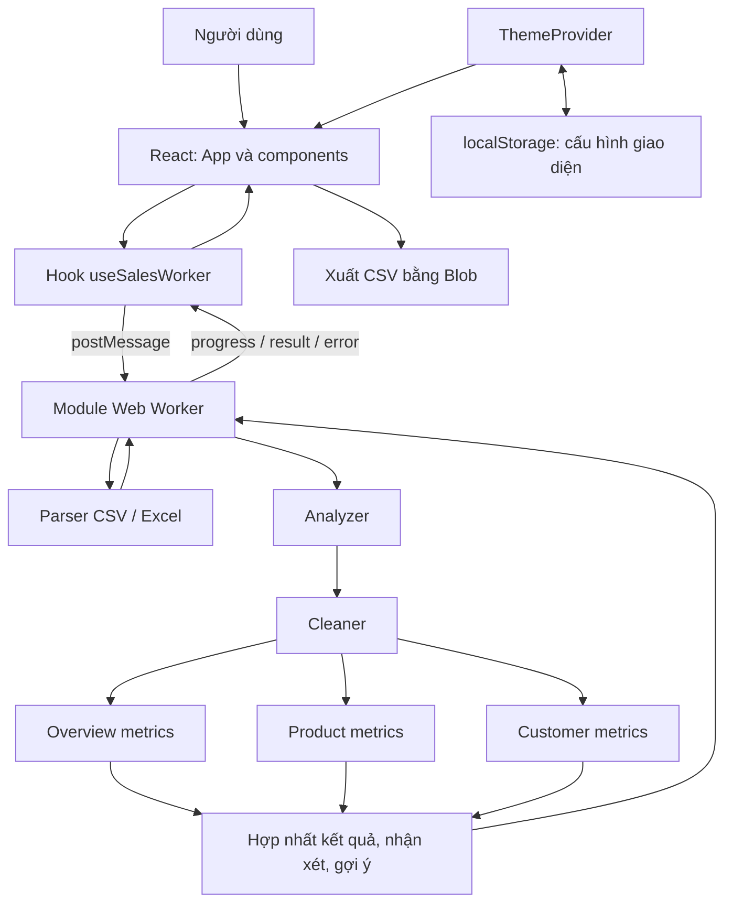
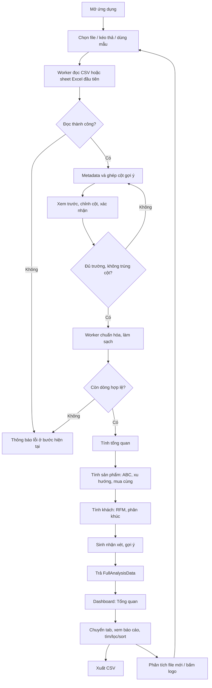
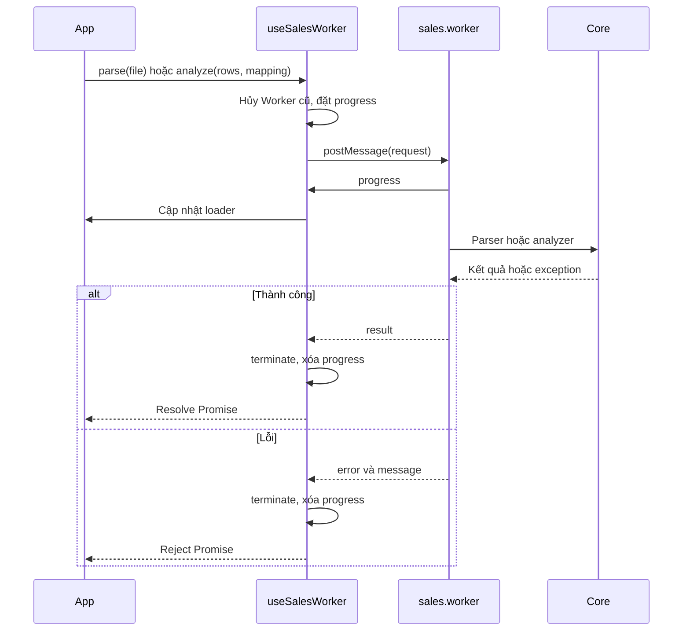

# Bán Hàng Smarter — Tài liệu đồ án phân tích dữ liệu bán lẻ

Ứng dụng web giúp chủ cửa hàng chuyển file bán hàng CSV/Excel thành báo cáo doanh thu, lợi nhuận gộp, phân tích sản phẩm và phân nhóm khách hàng. Kết quả gồm chỉ số, biểu đồ, bảng tra cứu, nhận xét tiếng Việt và gợi ý hành động theo quy tắc.

Tài liệu được đối chiếu với mã nguồn và dữ liệu trong dự án ngày **14/10/2026**. Nội dung mô tả chức năng đã triển khai, công thức đang sử dụng, cấu trúc chương trình và luồng xử lý thực tế.

## Mục lục

1. [Mục tiêu và phạm vi](#1-mục-tiêu-và-phạm-vi)
2. [Công nghệ và cấu hình](#2-công-nghệ-và-cấu-hình)
3. [Toàn bộ cấu trúc dự án](#3-toàn-bộ-cấu-trúc-dự-án)
4. [Kiến trúc và mô hình dữ liệu](#4-kiến-trúc-và-mô-hình-dữ-liệu)
5. [Đặc tả chức năng](#5-đặc-tả-chức-năng)
6. [Hệ thống luồng xử lý](#6-hệ-thống-luồng-xử-lý)
7. [Quy tắc làm sạch](#7-quy-tắc-làm-sạch)
8. [Công thức và thuật toán](#8-công-thức-và-thuật-toán)
9. [Định dạng đầu vào](#9-định-dạng-đầu-vào)
10. [Dữ liệu mẫu](#10-dữ-liệu-mẫu)
11. [Cài đặt và đóng gói](#11-cài-đặt-và-đóng-gói)
12. [Kiểm thử](#12-kiểm-thử)
13. [Hiệu năng, quyền riêng tư và giới hạn](#13-hiệu-năng-quyền-riêng-tư-và-giới-hạn)
14. [Hướng phát triển](#14-hướng-phát-triển)

## 1. Mục tiêu và phạm vi

### 1.1. Bài toán

File bán hàng thường chứa nhiều giao dịch, tên cột không thống nhất và dữ liệu thiếu hoặc sai. Chủ cửa hàng cần biết:

- Doanh thu và lợi nhuận trong kỳ là bao nhiêu, tháng nào bán tốt nhất?
- Mặt hàng nào tạo phần lớn doanh thu, mặt hàng nào bán chậm?
- Những sản phẩm nào thường được mua trong cùng một hóa đơn?
- Khách nào chi tiêu cao, mua thường xuyên hoặc đã lâu chưa quay lại?
- Có thể ưu tiên việc gì sau khi xem số liệu?

Ứng dụng giải quyết bằng chuỗi **đọc file → ghép cột → làm sạch → tính toán → trình bày → xuất báo cáo**.

### 1.2. Người sử dụng và phạm vi hệ thống

Đối tượng chính là chủ cửa hàng bán lẻ nhỏ, tiệm tạp hóa, cửa hàng thời trang hoặc người cần phân tích một file giao dịch. Hiện có một vai trò người dùng, không cần đăng ký/đăng nhập.

Dự án là **ứng dụng frontend một trang**. Dữ liệu bán hàng được xử lý trong bộ nhớ trình duyệt. Mã nguồn không triển khai backend, API nghiệp vụ, cơ sở dữ liệu, phân quyền hay kết nối trực tiếp đến phần mềm bán hàng. Người dùng xuất file từ hệ thống khác rồi mở trong ứng dụng.

Nhận xét và gợi ý được tạo bằng thuật toán và mẫu câu có sẵn; dự án không gọi mô hình AI để phân tích.

## 2. Công nghệ và cấu hình

Phiên bản dưới đây là khai báo trong `package.json`, không phải phiên bản mới nhất của thư viện.

| Thành phần | Phiên bản khai báo | Vai trò |
| --- | --- | --- |
| React / React DOM | `^19.2.8` | Giao diện, state và render |
| TypeScript | `~6.0.2` | Kiểu dữ liệu và kiểm tra mã nguồn |
| Vite | `^8.3.0` | Dev server, đóng gói ứng dụng và Worker |
| PapaParse | `^5.7.0` | Đọc CSV |
| SheetJS `xlsx` | `^0.18.5` | Đọc Excel và sinh Excel mẫu |
| Recharts | `^3.10.1` | Biểu đồ doanh thu, sản phẩm và khách |
| Lucide React | `^1.57.0` | Biểu tượng |
| canvas-confetti | `^1.9.4` | Hiệu ứng khi phân tích thành công |
| Tailwind CSS / plugin Vite | `^4.3.3` | Phụ thuộc và plugin đã cấu hình |
| Vitest | `^5.0.4` | Kiểm thử logic và pipeline |
| Playwright | `^1.64.0` | Kiểm thử giao diện trên Edge |
| Oxlint | `^1.81.0` | Kiểm tra mã nguồn, React hooks |
| Web APIs | Trình duyệt cung cấp | Worker, File, Blob, AbortController, localStorage, dialog, matchMedia |

**Giao diện thực tế:** CSS chủ yếu nằm trong `src/index.css`, gồm biến màu, chế độ tối, layout, hiệu ứng và class tiện ích tự định nghĩa. Vite có plugin Tailwind nhưng CSS hiện không nhập `@import "tailwindcss"`; không nên xem mọi class tiện ích trong JSX là chắc chắn đã được Tailwind sinh ra.

### 2.1. File cấu hình

| File | Nội dung và tác dụng |
| --- | --- |
| `package.json` | Package `model-data`, version `0.0.0`, ESM, phụ thuộc và lệnh npm |
| `package-lock.json` | Khóa cây phụ thuộc, dùng với `npm ci` |
| `vite.config.ts` | Plugin React/Tailwind; chưa đặt `base` hoặc proxy backend |
| `tsconfig.json` | Tham chiếu cấu hình ứng dụng và Node |
| `tsconfig.app.json` | Cho `src`; ES2023/DOM, module ESNext, bundler resolution, JSX `react-jsx`, `noEmit` |
| `tsconfig.node.json` | Cho `vite.config.ts`; ES2023, module NodeNext, types Node, kiểm tra biến/tham số chưa dùng |
| `.oxlintrc.json` | Plugin React/TypeScript/Oxc, rules-of-hooks và quy tắc export component |
| `playwright.config.ts` | Test browser một worker, Edge headless, cổng 5175, giữ trace khi lỗi |
| `.gitignore` | Bỏ qua dependencies, build, log và kết quả kiểm thử |
| `index.html` | HTML đầu vào, metadata tiếng Việt, favicon, khôi phục theme trước React |

`tsconfig.app.json` chưa bật `strict`; `noUnusedLocals`/`noUnusedParameters` đang false. `noEmit` nghĩa TypeScript kiểm tra kiểu, còn Vite tạo JavaScript cho bản build.

## 3. Toàn bộ cấu trúc dự án

```text
MODEL data/
├── index.html
├── package.json
├── package-lock.json
├── vite.config.ts
├── tsconfig.json
├── tsconfig.app.json
├── tsconfig.node.json
├── playwright.config.ts
├── .oxlintrc.json
├── .gitignore
├── README.md                         # Tài liệu tổng hợp đồ án
├── DECISIONS.md                      # Nhật ký quyết định thiết kế
├── IDEAS.md                          # Ý tưởng mở rộng
├── public/
│   ├── favicon.svg
│   ├── icons.svg
│   └── sample-data/
│       ├── du_lieu_ban_hang_mau.csv
│       └── du_lieu_ban_hang_mau.xlsx
├── scripts/
│   └── generate_sample_data.js
├── src/
│   ├── main.tsx                      # Khởi tạo React và ThemeProvider
│   ├── App.tsx                       # Điều phối các bước và dashboard
│   ├── index.css                     # Styles thực tế
│   ├── App.css                       # Chỉ chứa chú thích
│   ├── assets/
│   │   ├── hero.png
│   │   ├── react.svg
│   │   └── vite.svg
│   ├── core/
│   │   ├── types.ts
│   │   ├── parser.ts
│   │   ├── columnMapping.ts
│   │   ├── cleaner.ts
│   │   ├── analyzer.ts
│   │   ├── overviewMetrics.ts
│   │   ├── productMetrics.ts
│   │   ├── customerMetrics.ts
│   │   ├── textConclusions.ts
│   │   └── actionSuggestions.ts
│   ├── workers/
│   │   └── sales.worker.ts
│   ├── hooks/
│   │   └── useSalesWorker.ts
│   ├── theme/
│   │   ├── settings.ts
│   │   ├── ThemeProvider.tsx
│   │   └── useTheme.ts
│   ├── components/
│   │   ├── upload/
│   │   │   ├── FileUploadZone.tsx
│   │   │   ├── ColumnMapper.tsx
│   │   │   └── CleaningReportModal.tsx
│   │   ├── dashboard/
│   │   │   ├── OverviewTab.tsx
│   │   │   ├── ProductTab.tsx
│   │   │   ├── CustomerTab.tsx
│   │   │   └── KpiCard.tsx
│   │   ├── export/
│   │   │   └── exportCsv.ts
│   │   └── common/
│   │       ├── Header.tsx
│   │       ├── AnalysisLoader.tsx
│   │       ├── Pagination.tsx
│   │       ├── Dialog.tsx
│   │       ├── ThemeCustomizer.tsx
│   │       ├── AnimatedNumber.tsx
│   │       ├── Visuals.tsx
│   │       ├── ChartKit.tsx
│   │       └── chartGradients.tsx
│   └── test/
│       ├── cleaner.test.ts
│       ├── overviewMetrics.test.ts
│       ├── productMetrics.test.ts
│       ├── customerMetrics.test.ts
│       ├── analysisRegression.test.ts
│       ├── sampleDataset.test.ts
│       └── themeSettings.test.ts
├── tests/
│   └── browser/
│       └── dashboard.pw.ts
├── node_modules/                     # Dependencies đã cài
├── dist/                            # Kết quả đóng gói
├── artifacts/                       # Ảnh kiểm thử giao diện
└── test-results/                    # Kết quả/trace Playwright
```

Các thư mục dependencies/build/kết quả test là sản phẩm sinh ra, không phải tầng nghiệp vụ cần sửa trực tiếp.

### 3.1. Module xử lý

| File | Hàm/chức năng chính |
| --- | --- |
| `core/types.ts` | Kiểu ghép cột, bản ghi chuẩn, báo cáo làm sạch, chỉ số và kết quả tổng hợp |
| `core/parser.ts` | `parseSalesFile`, `parseCsvFile`, `parseXlsxFile`: đọc file, trả headers/xem trước |
| `core/columnMapping.ts` | `guessColumnMapping`: nhận diện tiêu đề bằng từ khóa Việt/Anh |
| `core/cleaner.ts` | `parseFlexibleNumber`, `parseFlexibleDate`, `cleanSalesData`: chuẩn hóa và loại lỗi |
| `core/overviewMetrics.ts` | `calculateOverviewMetrics`: doanh thu, đơn, AOV, lợi nhuận, tổng hợp tháng |
| `core/productMetrics.ts` | `calculateProductMetrics`: ABC, xu hướng, khuyến nghị, xếp hạng, mua cùng |
| `core/customerMetrics.ts` | `calculateCustomerMetrics`: tổng hợp khách, RFM và phân khúc |
| `core/textConclusions.ts` | Định dạng VND/số Việt Nam, sinh nhận xét template |
| `core/actionSuggestions.ts` | `generateActionSuggestions`: tối đa năm gợi ý theo điều kiện |
| `core/analyzer.ts` | `runFullAnalysis`/`runFullAnalysisAsync`: điều phối pipeline, hợp nhất kết quả |
| `workers/sales.worker.ts` | Nhận parse/analyze, gọi core, trả progress/result/error |
| `hooks/useSalesWorker.ts` | Cầu nối Promise React–Worker, tiến trình và hủy |

### 3.2. Module giao diện

| File/nhóm | Trách nhiệm |
| --- | --- |
| `App.tsx` | Bước upload/mapping/dashboard, dữ liệu, tab, lỗi, tải mẫu, hủy/reset |
| `upload/FileUploadZone.tsx` | Chọn/kéo file, dùng mẫu, tải CSV/Excel mẫu |
| `upload/ColumnMapper.tsx` | Xem trước 10 bản ghi, ghép cột, kiểm tra bắt buộc/trùng cột |
| `upload/CleaningReportModal.tsx` | Tổng dòng, hợp lệ, loại bỏ, lý do và số bản ghi mẫu |
| `dashboard/OverviewTab.tsx` | KPI tổng quan, biểu đồ tháng, top sản phẩm, gợi ý |
| `dashboard/ProductTab.tsx` | ABC, top doanh thu/lợi nhuận, mua cùng, bảng sản phẩm |
| `dashboard/CustomerTab.tsx` | Phân khúc, khách cần chăm sóc, bảng khách |
| `dashboard/KpiCard.tsx` | Thẻ chỉ số, báo thiếu dữ liệu khi value null |
| `common/Header.tsx` | Logo quay về đầu, dùng mẫu hoặc phân tích file mới |
| `common/AnalysisLoader.tsx` | Công đoạn, thanh tiến trình, skeleton, nút hủy |
| `common/Pagination.tsx` | Phân trang 20 kết quả |
| `common/Dialog.tsx` | Native dialog, Escape, focus, khóa cuộn nền |
| `common/ThemeCustomizer.tsx` | Chế độ, màu, mật độ, cỡ chữ, chuyển động |
| `common/AnimatedNumber.tsx` | Đếm số bằng requestAnimationFrame khi vào vùng nhìn thấy |
| `common/Visuals.tsx` | Reveal, RichText, Insight, SVG cửa hàng, thông báo thiếu dữ liệu |
| `common/ChartKit.tsx` | Tooltip biểu đồ định dạng số/tiền |
| `common/chartGradients.tsx` | Gradient SVG cho biểu đồ |
| `export/exportCsv.ts` | Tạo CSV, tải về bằng Blob, giải phóng URL tạm |
| `theme/settings.ts` | Bảng màu, mặc định, xác thực cấu hình |
| `theme/ThemeProvider.tsx` | Đọc/lưu theme, theo dõi hệ điều hành, đồng bộ các tab trình duyệt |
| `theme/useTheme.ts` | Context và hook theme |

Ảnh/logo trong `src/assets` hiện chưa được import vào component. Minh họa cửa hàng được vẽ bằng SVG trong `Visuals.tsx`; favicon tham chiếu từ `index.html`. `App.css` không chứa style đang dùng; dự án không có thư mục `src/styles` như mô tả thiết kế ban đầu.

## 4. Kiến trúc và mô hình dữ liệu

### 4.1. Quan hệ các tầng



Sơ đồ biểu diễn phụ thuộc và dữ liệu; các công đoạn phân tích thực tế chạy **tuần tự**. Hàm tính chỉ số độc lập với React. Parser dùng File/thư viện đọc file; export/theme dùng API trình duyệt.

### 4.2. Kiểu dữ liệu

| Kiểu | Nội dung | Nơi sử dụng |
| --- | --- | --- |
| `ColumnMappingConfig` | Chín trường trỏ đến tên cột nguồn | ColumnMapper, cleaner, kết quả |
| `ParseResult` | headers, previewRows, allRows, totalRows, fileName, fileSizeBytes | Parse và App |
| `CleanRow` | Ngày, sản phẩm, số lượng, tiền, khách, đơn chuẩn hóa | Đầu vào metrics |
| `CleaningReport` | Tổng dòng/hợp lệ/bị loại, lý do và số thứ tự mẫu | Modal |
| `OverviewMetrics` | KPI, độ đầy đủ mã đơn/giá vốn, kỳ thời gian, dữ liệu tháng | Tổng quan |
| `ProductMetricsItem` | Doanh thu, số lượng, ABC, lãi, xu hướng, khuyến nghị mỗi sản phẩm | Bảng/xếp hạng |
| `ProductAnalysisResult` | Toàn bộ sản phẩm, ABC summary, top 10, cặp mua cùng | Tab sản phẩm |
| `CustomerMetricsItem` | Chi tiêu, đơn, lần đầu/cuối, RFM, phân khúc, lời khuyên | Bảng khách |
| `CustomerAnalysisResult` | Toàn bộ khách, thống kê nhóm, top 15, danh sách theo phân khúc | Tab khách |
| `ActionSuggestion` | Loại, ưu tiên, tiêu đề, mô tả, nhãn chỉ số | Thẻ gợi ý |
| `FullAnalysisData` | cleaningReport, overview, productAnalysis, customerAnalysis, actionSuggestions, conclusions, columnMapping | Kết quả cuối trong App |

`CleanRow` chứa:

```text
rowIndex, orderId
 date, monthStr, timestamp
 productId, productName, category
 quantity, unitPrice, revenue
 costPrice, totalCost, profit
 customerId
```

Ngày chuẩn là YYYY-MM-DD, tháng là YYYY-MM; timestamp dùng so sánh thời gian. Giá vốn không hợp lệ thì costPrice/totalCost/profit là null; thiếu khách thì customerId null.

### 4.3. Quản lý trạng thái

App dùng state cục bộ React, chưa có Redux/Zustand/router:

- `step`: upload, mapping, dashboard.
- `tab`: overview, products, customers.
- `parsed`: dữ liệu thô và metadata.
- `analysis`: kết quả phân tích.
- `reportOpen`: mở/đóng báo cáo.
- `error`: lỗi đang hiển thị.
- `sampleLoading`: đang tải mẫu.
- `busy`: có progress Worker hoặc đang tải mẫu.

Bộ lọc/sắp xếp/trang nằm trong từng tab. Tab mount/unmount khi chuyển nên quay lại sẽ khởi tạo lại state tra cứu. Reload cần nhập file lại; chỉ cấu hình giao diện được lưu lâu dài.

## 5. Đặc tả chức năng

### 5.1. Nhập file và mẫu

- Nhận một file CSV/XLSX/XLS; kéo nhiều file chỉ xử lý file đầu.
- Chọn file từ thiết bị hoặc kéo thả.
- Nút khám phá tải CSV mẫu rồi đi qua ghép cột.
- Link tải CSV/Excel mẫu để xem, sửa hoặc nhập thử.
- Báo lỗi file rỗng, không hỗ trợ hoặc không đọc được.
- Không có ngưỡng dung lượng/số dòng cứng; phụ thuộc bộ nhớ thiết bị.

### 5.2. Ghép cột

Chín trường: ngày, sản phẩm, số lượng, doanh thu, đơn giá, giá vốn đơn vị, mã đơn, mã/tên khách, danh mục. Có gợi ý tự động, select chỉnh tay và bảng xem trước tối đa 10 bản ghi cùng tên file, kích thước, số dòng/cột.

Nút phân tích chỉ bật khi có ngày, sản phẩm, số lượng, ít nhất một trong doanh thu/đơn giá và không chọn một cột cho nhiều trường. Phỏng đoán chỉ là gợi ý; người dùng kiểm tra trước khi xác nhận.

### 5.3. Tiến trình và xử lý lỗi

- Parse và phân tích chạy trong Worker để giảm công việc trên luồng render.
- Loader hiển thị công đoạn, số dòng khi phân tích, phần trăm mốc và skeleton.
- Hủy tải mẫu bằng AbortController; hủy xử lý bằng terminate Worker.
- Hủy giữ bước hiện tại và không hiện lỗi.
- Lỗi hiện trong vùng role alert có nút đóng.
- Không còn dòng hợp lệ thì pipeline async báo lỗi, giữ màn hình ghép cột.

### 5.4. Báo cáo làm sạch

Dashboard hiển thị tên file, số hợp lệ/bị loại. Modal báo cáo có tổng đầu vào, số giữ/bỏ, các lý do và tối đa 5 số thứ tự mẫu cho mỗi lý do. Không có lỗi thì hiển thị tất cả bản ghi hợp lệ.

Số thứ tự tính từ bản ghi dữ liệu đầu, không bao gồm header. Không nhất thiết trùng số dòng vật lý của CSV nếu có dòng trống hoặc ô chứa xuống dòng.

### 5.5. Tab tổng quan

1. Bốn KPI chính: tổng doanh thu, lợi nhuận gộp, tổng đơn, AOV.
2. Khoảng ngày đầu–cuối và nhận xét tổng quan.
3. Biểu đồ vùng doanh thu/cột lợi nhuận theo tháng, lợi nhuận chỉ có khi có giá vốn.
4. Nhận xét tháng cao điểm và biến động hai tháng cuối có dữ liệu.
5. Top 5 sản phẩm doanh thu, tổng số mặt hàng/khách nhận diện.
6. Thẻ gợi ý hành động theo dữ liệu.
7. Hai KPI bổ sung: số khách VIP và số sản phẩm nhóm A.

Tổng đơn/AOV chỉ trình bày khi mọi dòng hợp lệ có mã đơn được coi là đáng tin cậy. KPI lợi nhuận kèm biên lãi và tỷ lệ doanh thu có giá vốn.

### 5.6. Tab sản phẩm

- Số sản phẩm, doanh thu, tỷ trọng A/B/C và nhận xét ABC.
- Biểu đồ ngang top 10 doanh thu.
- Nhận xét mặt hàng lãi cao nhất, tối đa 4 mặt hàng trong top lợi nhuận.
- Số mặt hàng cần cân nhắc bỏ lấy từ danh sách slowMoving đã giới hạn 10.
- Tối đa 4 cặp mua cùng từ danh sách top 10.
- Bảng toàn bộ sản phẩm: tên/danh mục, số lượng, doanh thu, ABC, lợi nhuận nếu có, xu hướng, khuyến nghị.
- Tìm tên/mã; lọc ABC/khuyến nghị; sort tên/số lượng/doanh thu/lợi nhuận tăng giảm.
- Phân trang 20 kết quả, xuất CSV toàn bộ kết quả đang lọc theo thứ tự sắp xếp.

Lý do khuyến nghị nằm trong tooltip của nhãn. Core có chuỗi xu hướng theo tháng từng sản phẩm nhưng UI chưa có trang chi tiết hoặc biểu đồ riêng cho mỗi sản phẩm.

### 5.7. Tab khách hàng

Thiếu khách thì hướng dẫn thêm cột khách. Có khách nhưng mã đơn chưa đầy đủ thì chỉ hiện số khách nhận diện và hướng dẫn bổ sung hóa đơn.

Đủ điều kiện thì có:

- Bốn KPI: tổng khách, VIP, cần chăm sóc, khách mới.
- Nhận xét VIP/nguy cơ, biểu đồ quy mô sáu phân khúc.
- Mốc Recency là ngày giao dịch cuối trong file.
- Tối đa 4 khách có nguy cơ được ưu tiên hiển thị.
- Bảng **toàn bộ khách**, không giới hạn bởi top 15.
- Tìm mã/tên, lọc phân khúc, sort mã/chi tiêu/số đơn/số ngày chưa mua.
- Phân trang 20 kết quả, xuất toàn bộ kết quả lọc sang CSV.

Bảng có chi tiêu, số đơn, lần cuối, số ngày chưa mua, phân khúc, lời khuyên. Điểm RFM, lần mua đầu và AOV khách có trong core nhưng chưa thành cột UI.

### 5.8. Gợi ý hành động

| Điều kiện | Gợi ý | Ưu tiên |
| --- | --- | --- |
| Có khách nguy cơ | Chăm sóc khách từng chi nhiều/mua thường xuyên nhưng vắng >60 ngày | high |
| Có sản phẩm | Ưu tiên nguồn hàng nhóm A | high |
| Có slowMoving | Thanh lý/cân nhắc ngừng nhập mặt hàng chậm | medium |
| Có mã đơn thật và cặp | Thử combo hoặc đặt mặt hàng cạnh nhau | medium |
| Đủ mã đơn, AOV dương | Ưu đãi nâng giá trị hóa đơn | info |

Xét theo thứ tự bảng, lấy tối đa 5; không bảo đảm luôn có ít nhất 3. Analyzer bỏ gợi ý chăm sóc khách nếu mã đơn chưa đáng tin cậy. Ứng dụng chỉ đề xuất nội dung, không tự gửi SMS/Zalo, đặt hàng hoặc tạo khuyến mãi.

### 5.9. Xuất CSV

`bao_cao_san_pham.csv`: mã, tên, danh mục, ABC, số lượng, doanh thu, lợi nhuận trên phần đủ giá vốn, khuyến nghị.

`bao_cao_khach_hang.csv`: mã, tên, phân khúc, tổng chi tiêu, số đơn, số ngày chưa mua, lời khuyên.

Exporter thêm UTF-8 BOM, dùng dấu phẩy, đặt ô trong dấu nháy kép, escape nháy, xuống dòng CRLF. Null/undefined thành ô rỗng. Chuỗi bắt đầu bằng ký tự có thể được spreadsheet hiểu là công thức được thêm nháy đơn để giữ văn bản. File chứa toàn bộ kết quả lọc, không chỉ trang đang mở.

### 5.10. Giao diện và tương tác

- Sáng/tối/hệ thống; nền tối hiện dùng đen/xám.
- Năm màu: Lục bảo, Indigo, San hô, Đại dương, Hoàng kim; biểu đồ đổi cùng palette.
- Thoáng/Gọn: được lưu và gắn data-density nhưng CSS chưa có quy tắc riêng theo thuộc tính này.
- Font gốc 16/18/20px; nhiều component vẫn dùng px cố định nên không phải mọi chữ tăng theo.
- Giảm chuyển động theo người dùng hoặc hệ điều hành: bỏ đếm số, animation biểu đồ/confetti và rút ngắn animation/transition CSS.
- Reset mặc định: system, emerald, comfortable, 16px, tùy chọn giảm chuyển động riêng tắt.
- Lưu cấu hình xác thực tại `banhang-theme-v1`, đồng bộ bằng sự kiện storage.
- Tab hỗ trợ ArrowLeft/ArrowRight/Home/End; dialog hỗ trợ Escape và trả focus về nút mở.
- Bảng cuộn ngang; layout chính có breakpoint 960px/768px.

## 6. Hệ thống luồng xử lý

### 6.1. Luồng nghiệp vụ



### 6.2. Khởi tạo

1. index.html khôi phục theme sớm bằng script trong head để giảm nhấp nháy.
2. main.tsx tạo root, bọc App bằng StrictMode/ThemeProvider.
3. ThemeProvider xác thực cấu hình, theo dõi chế độ hệ điều hành.
4. App bắt đầu upload, tab overview và dữ liệu rỗng.

### 6.3. Đọc file

1. FileUploadZone gọi upload(file) trong App.
2. App xóa lỗi cũ, gọi worker.parse(file).
3. Hook tạo module Worker, đăng ký handler, gửi `{ type: 'parse', file }`.
4. Worker gọi parseSalesFile, chọn parser theo đuôi file không phân biệt hoa/thường.
5. CSV: file.text() đọc toàn bộ; PapaParse dùng header, trim tên cột, bỏ dòng trống, từ chối lỗi số trường/dấu nháy.
6. Excel: ArrayBuffer → SheetJS → **sheet đầu tiên** → object; ô trống thành chuỗi rỗng.
7. Parser trả ParseResult gồm 10 bản ghi preview và toàn bộ allRows.
8. Hook dừng Worker; App lưu parsed và chuyển mapping.

Dùng mẫu thêm bước fetch từ BASE_URL/sample-data → Blob → File → cùng pipeline trên. Người dùng vẫn xác nhận ghép cột.

### 6.4. Nhận diện cột

guessColumnMapping viết thường/trim tiêu đề, bỏ dấu, đổi đ→d, đổi ký tự ngoài chữ/số thành khoảng trắng, gộp khoảng trắng. Ưu tiên khớp chính xác từ khóa, sau đó khớp chuỗi con. Cột đã dùng không được tự gán lại; trường sản phẩm ưu tiên tên trước mã/SKU.

ColumnMapper giữ mapping riêng, kiểm tra trường bắt buộc/trùng sau mỗi lựa chọn. Xác nhận gửi parsed.allRows và mapping sang bước phân tích.

### 6.5. Pipeline và tiến trình

Worker nhận `{ type: 'analyze', rows, mapping }`, gọi runFullAnalysisAsync:

| Mốc | Công đoạn tiếp theo |
| --- | --- |
| 5% ở hook | Chuẩn bị yêu cầu |
| 15% | Chuẩn hóa và làm sạch |
| 35% | Tính tổng quan |
| 55% | Sản phẩm, ABC, xu hướng, mua cùng |
| 75% | Khách hàng, RFM |
| 92% | Nhận xét, gợi ý, hợp nhất |
| 100% | Hoàn tất |

Mỗi mốc gửi message rồi nhường event loop bằng setTimeout(..., 0). Phần trăm là mốc công đoạn, **không phải tỷ lệ dòng đã xử lý**; không cập nhật theo từng dòng trong một công đoạn.

App nhận kết quả, lưu analysis, chuyển dashboard và chọn overview. Confetti import động, chỉ chạy khi tùy chọn chuyển động hiện tại cho phép.

runFullAnalysis đồng bộ chủ yếu dùng trong test. Hai phiên bản dùng chung finishAnalysis; async thêm các mốc tiến trình và kiểm tra không còn dòng hợp lệ.

### 6.6. Giao tiếp React–Worker



Hook tạo Worker mới cho mỗi yêu cầu, không lưu phiên giữa hai bước. postMessage sao chép dữ liệu theo cơ chế trình duyệt, chưa dùng Transferable ArrayBuffer xuyên suốt pipeline.

### 6.7. Hủy, reset, export

**Hủy:** abort tải mẫu, terminate Worker, reject Promise bằng AbortError, xóa progress. App bỏ qua lỗi hủy, giữ dữ liệu/bước trước đó.

**Reset:** hủy công việc, dừng confetti, xóa parsed/analysis/error, đóng report, về upload. Cấu hình giao diện vẫn lưu.

**Export:** toàn bộ dữ liệu → filtered → sort → chọn cột → UTF-8 BOM → Blob → object URL → link download → xóa link/revoke URL. Phân trang chỉ giới hạn render, không giới hạn file xuất.

## 7. Quy tắc làm sạch

### 7.1. Thứ tự

Thiếu mapping bắt buộc: trả zero dòng hợp lệ và missing_required_columns cho toàn bộ đầu vào. Mỗi bản ghi được kiểm tra:

1. Ngày bán.
2. Sản phẩm sau trim.
3. Số lượng dương.
4. Doanh thu/đơn giá dương.
5. Mã đơn/khách và chữ ký trùng.
6. Giá vốn/lợi nhuận/danh mục, tạo CleanRow.

Một bản ghi nhiều lỗi chỉ đếm lỗi đầu tiên gặp.

| Lý do | Điều kiện |
| --- | --- |
| missing_required_columns | Thiếu cấu hình bắt buộc |
| missing_date | Ngày rỗng/không parse được |
| missing_product | Tên/mã rỗng |
| invalid_quantity | Không phải số hợp lệ hoặc ≤0 |
| invalid_revenue | Doanh thu/đơn giá không hợp lệ hoặc ≤0 |
| duplicate | Chữ ký đã xuất hiện |

### 7.2. Số và ngày

Số hỗ trợ number hữu hạn, ký hiệu đ/₫/$/vnd, khoảng trắng, chấm/phẩy, hậu tố k/m/tr. Ví dụ 125.000→125000, 50k→50000, 2.5tr→2500000. Chuỗi như 123abc, NaN/Infinity đưa về 0 để kiểm tra tiếp.

Một chấm/phẩy với ba chữ số phía sau có thể được hiểu là hàng nghìn; file nên thống nhất định dạng để tránh mơ hồ.

Ngày hỗ trợ Date từ SheetJS, Excel serial dạng số trong khoảng 30000–60000 (không gồm hai đầu), chuỗi năm-tháng-ngày/ngày-tháng-năm với -, / hoặc dấu chấm. Nhánh định dạng rõ kiểm tra ngày thực trong lịch, loại 31/02/2026. Fallback dùng Date JavaScript, giới hạn năm 2000–2100. Khuyến nghị ISO/DD/MM/YYYY để tránh phụ thuộc trình duyệt.

### 7.3. Doanh thu, giá vốn và danh mục

- Có ô doanh thu không rỗng: dùng giá trị đó. Có ô đơn giá thì parse; thiếu thì suy revenue/quantity.
- Thiếu ô doanh thu và có mapping đơn giá: quantity×unitPrice.
- Ô doanh thu có giá trị nhưng sai/≤0 không tự được thay bằng doanh thu từ đơn giá.
- Giá vốn chỉ hợp lệ khi >0. Thiếu/sai/0/âm thành null nhưng không loại bản ghi bán hàng.
- totalCost=quantity×costPrice; profit=revenue−totalCost.
- Lợi nhuận có thể âm nếu doanh thu dương nhưng thấp hơn giá vốn.
- Danh mục thiếu mặc định Chung.

### 7.4. Mã đơn và trùng lặp

Thiếu mã đơn tạo `AUTO-YYYY-MM-DD-STT`. Chữ ký là:

```text
ngày | mã đơn | sản phẩm | số lượng | doanh thu | khách
```

Đây là trùng theo trường nghiệp vụ chuẩn hóa, không so sánh mọi ô gốc; giá vốn/danh mục không trong chữ ký. Mã AUTO có STT riêng nên bản sao thiếu mã đơn có thể không được nhận diện. Hai dòng bán hợp lệ trong cùng hóa đơn có chữ ký giống nhau cũng sẽ chỉ giữ một.

## 8. Công thức và thuật toán

### 8.1. Tổng quan

Với R là tập hợp lệ, C là tập con có giá vốn:

```text
Tổng doanh thu       = Σ revenue(r), r thuộc R
Tổng số lượng        = Σ quantity(r), r thuộc R
Tổng đơn nội bộ      = số orderId khác nhau
AOV                  = tổng doanh thu / tổng đơn
Lợi nhuận gộp        = Σ profit(r), r thuộc C
Biên lãi (%)         = lợi nhuận / Σ revenue(r), r thuộc C × 100
Độ phủ giá vốn (%)   = Σ revenue(r), r thuộc C / tổng doanh thu × 100
Số mặt hàng          = số productId khác nhau
Số khách             = số customerId khác nhau, bỏ dòng không có khách
Số ngày trong kỳ     = max(1, round((ngày cuối − ngày đầu)/1 ngày) + 1)
```

Không giá vốn: lợi nhuận/biên lãi null; thiếu khách toàn bộ: uniqueCustomers null. Doanh thu/lợi nhuận/AOV làm tròn số nguyên, biên lãi một chữ số thập phân, coverage số nguyên phần trăm.

hasReliableOrderIds=true khi **mọi dòng hợp lệ** có mã không bắt đầu AUTO-. Mã AUTO vẫn gom dữ liệu nội bộ, nhưng UI ẩn số đơn/AOV khi cờ false.

Tháng nhóm bằng monthStr và sort tăng, không thêm tháng không có dữ liệu. Nhận xét hai tháng cuối: tăng từ 5%, giảm từ -5%, còn lại ổn định; mẫu câu dùng mức thay đổi 0 nếu tháng trước doanh thu 0.

Ví dụ test độc lập: ba dòng 100.000đ, hai hóa đơn, 17 sản phẩm, tổng vốn 190.000đ → doanh thu 300.000đ, AOV 150.000đ, lợi nhuận 110.000đ, biên lãi 36,7%.

### 8.2. ABC

Gom productName, sort doanh thu giảm, tính tỷ trọng/tích lũy. Xét tích lũy **trước sản phẩm đang xét**:

| Tích lũy trước sản phẩm | Nhóm |
| --- | --- |
| <80% hoặc sản phẩm đầu | A |
| 80% đến <95% | B |
| ≥95% | C |

Sản phẩm vượt ngưỡng vẫn thuộc nhóm đang lấp đầy; A có thể >80% doanh thu. Không ép đúng 80/15/5 hoặc đúng 20% số sản phẩm trong A.

Chỉ mapping một trường sản phẩm: productId=productName=giá trị cột chọn. Chọn tên có thể gộp SKU trùng tên; chọn mã thì UI hiện mã. Danh mục lấy từ bản ghi đầu gặp.

Giá vốn bình quân=totalCost/số lượng có giá vốn; profit/biên lãi chỉ tính phần doanh thu có giá vốn.

### 8.3. Xu hướng và khuyến nghị

Dùng hai tháng cuối có giao dịch trong toàn tập, không nhất thiết liên tiếp theo lịch:

```text
changePercent = (doanh thu tháng cuối − tháng trước) / tháng trước × 100
```

- Trước 0, cuối >0: Mới xuất hiện.
- Trước >0: >10% Tăng trưởng, <-10% Giảm sút, còn lại Ổn định.
- Cả hai 0 khi có tháng trước: Giảm sút.
- Chỉ một tháng: mặc định Ổn định.

| Điều kiện | Khuyến nghị |
| --- | --- |
| A | Đáng đầu tư |
| B và tăng trưởng | Đáng đầu tư |
| B còn lại | Duy trì ổn định |
| C và giảm sút hoặc cuối tháng không doanh thu | Cân nhắc loại bỏ |
| C còn lại | Duy trì ổn định |

Khuyến nghị dựa ABC/xu hướng, chưa dùng biên lợi nhuận làm điều kiện. Lấy top 10 doanh thu, top 10 lợi nhuận dương, tối đa 10 slowMoving.

### 8.4. Mua cùng

hasOrderId=true khi có **ít nhất một** mã thật không bắt đầu AUTO-, nhẹ hơn điều kiện mã đầy đủ của tổng quan.

Tạo Set tên sản phẩm mỗi hóa đơn; với k≥2 liệt kê k×(k−1)/2 cặp, mỗi cặp đếm một lần/hóa đơn.

```text
Tỷ lệ cặp (%) = số hóa đơn có cả hai sản phẩm
                 / số hóa đơn có ít nhất hai sản phẩm khác nhau × 100
```

Sort số lần giảm, lấy top 10. Không lọc ngưỡng tối thiểu; cặp xuất hiện một lần vẫn có thể có kết quả. Chưa tính confidence/lift hay luật kết hợp đầy đủ.

### 8.5. Khách hàng và RFM

Bỏ dòng không customerId, gom các dòng còn lại:

- R: ngày từ lần mua cuối của khách đến ngày muộn nhất **toàn bộ file hợp lệ**, kể cả dòng không có khách.
- F: số orderId khác nhau của khách.
- M: tổng doanh thu gắn với khách.
- AOV khách: totalSpend/ordersCount.

Sort khách theo chi tiêu giảm, tính ngưỡng:

```text
N = tổng số khách
index = min(N−1, max(0, floor(N×0,2)))          // mảng đánh số từ 0
ngưỡng VIP = min(chi tiêu khách ở index, 1,2×chi tiêu trung bình)
chi tiêu cao: totalSpend ≥ ngưỡng VIP
mua thường xuyên: ordersCount ≥ 4
```

Không bảo đảm đúng 20% khách là chi tiêu cao. Phân khúc xét lần lượt:

| Ưu tiên | Điều kiện | Nhóm |
| --- | --- | --- |
| 1 | Chi cao, R≤60 | VIP |
| 1 | Chi cao, R>60 | Có nguy cơ rời đi |
| 2 | Không thuộc trên, ≥4 đơn, R≤60 | Trung thành |
| 2 | Không thuộc trên, ≥4 đơn, R>60 | Có nguy cơ rời đi |
| 3 | Còn lại, 1 đơn, R≤45 | Mới |
| 3 | Còn lại, 1 đơn, R>120 | Đã ngừng mua |
| 3 | Còn lại, 1 đơn, R46–120 | Bình thường |
| 4 | Còn lại, 2–3 đơn, R>90 | Đã ngừng mua |
| 4 | Còn lại | Bình thường |

Chi cao chỉ mua một lần vẫn ưu tiên VIP/nguy cơ. Khách chi cao hoặc thường xuyên vắng rất lâu vẫn ở nguy cơ theo thứ tự này.

| Điểm | Quy tắc |
| --- | --- |
| R | ≤30:5; ≤60:4; ≤90:3; ≤180:2; còn lại:1 |
| F | ≥8:5; ≥5:4; ≥3:3; ≥2:2; còn lại:1 |
| M | ≥ngưỡng VIP:5; ≥50%:4; ≥25%:3; còn lại:2 |
| Tổng | R+F+M |

Phân khúc không suy trực tiếp từ tổng điểm. Kết quả có top 15, **toàn bộ khách**, sáu nhóm. Tỷ trọng doanh thu nhóm dùng chi tiêu các khách được nhận diện làm mẫu số, không phải tổng doanh thu gồm dòng thiếu khách.

Tên khách hiện lấy chính customerId, chưa mapping riêng mã và tên.

### 8.6. Nhận xét

textConclusions.ts nội suy template: tổng quan, tháng cao điểm, ABC, lãi cao nhất, khách. Tiền dùng locale Việt Nam, rút gọn triệu/tỷ.

RichText chuyển đoạn **...** thành strong bằng React, không chèn HTML từ file. Nhận xét mua cùng trong FullAnalysisData tạo trực tiếp ở finishAnalysis; generateCoOccurrenceConclusion có sẵn nhưng chưa được pipeline gọi.

## 9. Định dạng đầu vào

Mỗi bản ghi là **một mặt hàng trong hóa đơn**. Hóa đơn nhiều mặt hàng lặp cùng mã ở các dòng. Doanh thu là thành tiền dòng hàng, không phải tổng hóa đơn lặp lại.

| Trường | Bắt buộc | Ý nghĩa |
| --- | --- | --- |
| Ngày | Có | YYYY-MM-DD hoặc DD/MM/YYYY khuyến nghị |
| Sản phẩm | Có | Khóa nhóm đồng thời tên hiển thị |
| Số lượng | Có | Dương |
| Doanh thu | Một trong hai | Thành tiền dòng dương |
| Đơn giá | Một trong hai | Giá bán đơn vị, tính revenue khi thiếu |
| Giá vốn | Không | Vốn **một đơn vị**, không phải tổng vốn dòng |
| Mã đơn | Không, cần cho số đơn/AOV/RFM | Mã ổn định, không tái dùng cho đơn khác |
| Khách | Không | Nên dùng mã khách ổn định |
| Danh mục | Không | Thiếu dùng Chung |

```csv
Mã đơn hàng,Ngày bán,Tên sản phẩm,Số lượng,Đơn giá,Doanh thu,Giá vốn,Mã khách hàng,Danh mục
DH001,2026-09-01,Cà phê,2,50000,100000,30000,KH001,Đồ uống
DH001,2026-09-01,Sữa đặc,1,26000,26000,19500,KH001,Thực phẩm
DH002,2026-09-03,Trà,3,20000,60000,12000,KH002,Đồ uống
```

CSV nên UTF-8, hàng đầu header, escape đúng nháy/phân cách. Excel đặt dữ liệu ở sheet đầu, hàng đầu header; tránh tiêu đề trang trí/ô merge.

### 9.1. Thiếu trường tùy chọn

| Tình trạng | Hành vi |
| --- | --- |
| Không giá vốn hợp lệ | Lợi nhuận/biên lãi null, UI báo thiếu |
| Một phần có vốn | Tính trên phần đó, hiện coverage tổng quan |
| Không khách | Tổng quan/sản phẩm vẫn có, tab khách hướng dẫn |
| Có khách nhưng mã đơn thiếu bất kỳ dòng hợp lệ | Tab khách ẩn RFM/bảng, yêu cầu mã đơn |
| Thiếu mọi mã đơn | Ẩn số đơn/AOV, không mua cùng |
| Chỉ một phần mã thật | Ẩn số đơn/AOV/RFM, có thể vẫn có cặp từ đơn nhận diện |
| Không danh mục | Chung |
| Không doanh thu, có đơn giá | quantity×unitPrice |

## 10. Dữ liệu mẫu

CSV/XLSX hiện có **5.031 bản ghi**, 11 cột, 50 sản phẩm, 300 khách; từ 01/10/2025–30/09/2026. Sheet Excel là BanHang2025_2026. Con số 5.030 trên một số nhãn UI/tên test là mô tả cũ; màn hình ghép cột đếm số thực tế.

Script sinh giao dịch ngẫu nhiên, 50 mặt hàng, 300 khách có trọng số mua khác nhau, nhóm chỉ mua đầu kỳ và các cặp như cà phê–sữa đặc/nước giặt–nước xả.

80 lỗi chủ ý: 30 bản sao, 15 thiếu ngày, 15 số âm, 10 số lượng 0, 10 thiếu sản phẩm. Vòng thêm hóa đơn có thể vượt mốc vài dòng, Math.random không seed và có thể phát sinh trùng nghiệp vụ khác; không bảo đảm lần sinh lại có cùng số dòng/chỉ số.

`npm run generate-sample` ghi đè cả CSV và XLSX. Test mẫu dùng ngưỡng thay vì cố định mọi tổng tiền.

## 11. Cài đặt và đóng gói

### 11.1. Môi trường

Khuyến nghị **Node.js 24**. Engines trong package cục bộ: Vite yêu cầu `^20.19.0 || >=22.12.0`; Vitest yêu cầu `^22.12.0 || ^24.0.0 || >=26.0.0`. Hướng dẫn Node 18 cũ không phù hợp bộ phụ thuộc này.

Cần npm, trình duyệt hiện đại hỗ trợ module Worker/dialog/matchMedia/IntersectionObserver; cần Edge đã cài nếu chạy cấu hình Playwright hiện tại.

### 11.2. Chạy

```bash
npm ci
npm run dev
```

Dùng URL Vite in terminal, thường localhost:5173; cổng bị chiếm có thể đổi. Không cần .env, API key hay database. PowerShell có thể dùng npm.cmd nếu môi trường chặn npm.ps1.

### 11.3. Các lệnh

| Lệnh | Tác dụng |
| --- | --- |
| npm run dev | Vite dev server |
| npm run build | tsc -b rồi Vite build vào dist |
| npm run preview | Xem thử bản build |
| npm run lint | Oxlint |
| npm run test | Vitest một lần |
| npm run test:watch | Vitest theo dõi |
| npm run test:ui | Playwright |
| npm run generate-sample | Ghi đè dữ liệu mẫu mới |

### 11.4. Triển khai

```bash
npm run build
npm run preview
```

Dist gồm HTML, chunk JS/CSS, Worker, favicon và file mẫu public. Phục vụ bằng web server tĩnh, không cần backend nghiệp vụ.

Nếu chạy dưới đường dẫn con, cấu hình base của Vite và kiểm tra tài nguyên. Tải mẫu dùng BASE_URL, favicon HTML hiện dùng `/favicon.svg`. Mở file HTML trực tiếp qua file:// không thay thế web server cho module/Worker.

## 12. Kiểm thử

### 12.1. Vitest

| File | Phạm vi |
| --- | --- |
| cleaner.test.ts | Số/ngày, loại lỗi/báo cáo, doanh thu từ đơn giá |
| overviewMetrics.test.ts | Kiểm tra tay doanh thu/số lượng/đơn/AOV/lợi nhuận/biên lãi, thiếu vốn |
| productMetrics.test.ts | ABC, khuyến nghị, xu hướng, mua cùng |
| customerMetrics.test.ts | Thiếu khách, VIP/nguy cơ/mới |
| analysisRegression.test.ts | Vốn thiếu một phần, cờ mã đơn, ngày không tồn tại, số sai, ưu tiên tên, sync/async tương đương |
| sampleDataset.test.ts | Pipeline core trên mẫu, 50 sản phẩm/300 khách/lỗi/kết quả |
| themeSettings.test.ts | Xác thực và khôi phục cấu hình hỏng |

Ngày 14/10/2026, chạy `npm.cmd run test`: **7 file, 21 test đạt**. Test mẫu là tích hợp core, không thao tác trình duyệt hay parser File giao diện.

### 12.2. Playwright

Bốn kịch bản trong tests/browser/dashboard.pw.ts:

1. Mẫu→mapping→dashboard; theme/màu chart, tìm/xuất CSV, phân trang khách, modal, cấu hình sau reload.
2. CSV 50.000 dòng, doanh thu/số đơn, tương tác và reduced motion.
3. Mobile 390×844, theme hệ điều hành, thiếu dữ liệu.
4. Hủy tải mẫu, Excel, phân tích file mới.

```powershell
npm.cmd run test:ui
```

Tự bật Vite tại http://127.0.0.1:5175, Edge headless, rồi dừng server. Ảnh ở artifacts; kết quả/trace lỗi ở test-results. webServer dùng npm.cmd, cần chỉnh khi chạy ngoài Windows.

Playwright chưa chạy lại trong lần cập nhật tài liệu này; ảnh có sẵn không chứng minh mã hiện tại pass. Ví dụ test 50.000 dòng đòi animationName=none nhưng CSS reduced motion chỉ rút ngắn thời lượng; cần đối chiếu khi chạy lại.

## 13. Hiệu năng, quyền riêng tư và giới hạn

### 13.1. Hiệu năng

Worker tách parse/tính toán khỏi render; dashboard lazy-load theo tab, confetti import động. Bảng render 20 dòng, useMemo lọc/sort. Map/Set nhóm khách/sản phẩm/đơn. Đếm số bắt đầu khi vào viewport, reduced motion tránh animation tương ứng.

Toàn file vẫn vào bộ nhớ; postMessage truyền bản ghi, App giữ cả parsed và analysis. Chưa streaming/không giới hạn. Kịch bản 50.000 dòng không phải benchmark bảo đảm mọi file/thiết bị. Ghép cặp tăng theo bình phương số mặt hàng trong một hóa đơn.

### 13.2. Quyền riêng tư

Mã không gửi file/giao dịch lên server, không lưu file trong localStorage, không gọi API phân tích bên ngoài. Worker chạy trên thiết bị, không phải server từ xa.

Ứng dụng vẫn tải tài nguyên, mẫu từ hosting và font Google Fonts qua CSS. Cách mô tả đúng là **phân tích dữ liệu bán hàng cục bộ**, không phải hoàn toàn không có mạng. Chưa service worker/cache offline bảo đảm mở lại khi mất mạng.

Tên trong file render như văn bản React; export xử lý chuỗi giống công thức spreadsheet. Đây là biện pháp cụ thể trong mã, không phải cam kết bảo mật tuyệt đối mọi môi trường.

### 13.3. Giới hạn nghiệp vụ và giao diện

- Chỉ sheet đầu; chưa chọn/gộp nhiều sheet/file.
- Chưa lọc khoảng ngày toàn dashboard; phân tích toàn file sau làm sạch.
- Dòng âm/0 bị loại; chưa nghiệp vụ hoàn trả qua giao dịch âm.
- Lợi nhuận gộp chưa trừ vận hành/thuế/thuê mặt bằng/nhân sự.
- Mã đơn nhóm toàn cục; tái dùng mã có thể sai đơn/giỏ hàng/tần suất.
- Cờ mã đơn chỉ kiểm tra có mã/tiền tố AUTO-, chưa kiểm tra cùng ngày/khách.
- Chưa tách mã–tên; có thể gộp nhầm sản phẩm/khách trùng tên.
- Chữ ký trùng có thể bỏ dòng hợp lệ giống nhau trong đơn; thiếu mã lại có thể bỏ sót bản sao.
- Xu hướng chưa hiệu chỉnh tháng thiếu, tháng cuối chưa đủ hoặc mùa vụ.
- Recency theo cuối file, không theo hôm nay; RFM là quy tắc, không mô hình dự đoán xác suất.
- Khi mã đơn thiếu, core vẫn tính nhóm khách; tab khách ẩn và gợi ý khách bị bỏ, nhưng KPI VIP cuối tổng quan hiện chỉ kiểm tra có khách. Chỉ nên dùng KPI này khi mã đầy đủ.
- Mật độ có state/lưu trữ nhưng chưa CSS riêng; một số class tiện ích chưa được định nghĩa.
- Chưa lưu lịch sử báo cáo; reload mất phiên dữ liệu.
- Chỉ xuất CSV sản phẩm/khách, chưa PDF/ảnh biểu đồ/Excel kết quả.

## 14. Hướng phát triển

| Hướng trong IDEAS.md | Hiện trạng và phần bổ sung |
| --- | --- |
| Dự báo tồn kho/hết hàng | Đã gợi ý nguồn hàng; cần số tồn và mô hình ngày đủ hàng |
| MoM/YoY | Có nhận xét hai tháng cuối; cần chọn kỳ/cùng kỳ, xử lý tháng thiếu/chưa đủ |
| Heatmap giờ/ngày | Chưa có; cần giữ giờ và tổng hợp khung giờ |
| In/PDF | Chưa có; cần layout và cơ chế xuất/in |
| IndexedDB lịch sử | Chưa có; cần phiên/schema/giới hạn dung lượng/xóa |

Các cải tiến trực tiếp: tách mã/tên sản phẩm/khách, chọn sheet, cảnh báo mã đơn không nhất quán, cải thiện loại trùng, hoàn trả hàng, hoàn thiện CSS mật độ/responsive và cập nhật test UI theo hành vi thực tế.

DECISIONS.md giữ lịch sử thiết kế; một số mô tả như src/styles, nền tối, số dòng mẫu không còn trùng mã. Khi xác định hành vi hiện tại, đối chiếu tài liệu này và module tương ứng.
